# Hi, I'm Shobhit Sharma 👋

<picture>
  <source media="(prefers-color-scheme: dark)" srcset="./dark.svg">
  <source media="(prefers-color-scheme: light)" srcset="./light.svg">
  
</picture>

  <b>Full Stack Developer · Workflow Automation · Backend Systems · Cloud Deployment</b>

  ⚛️ React / Next.js &nbsp;·&nbsp; ⚙️ Node.js / Express &nbsp;·&nbsp; 🤖 n8n & Automation &nbsp;·&nbsp; 🗄️ MongoDB / MySQL / Prisma &nbsp;·&nbsp; ☁️ AWS / Vercel &nbsp;·&nbsp; 🔌 REST APIs & Webhooks

Full Stack Developer with experience in designing, building, and deploying responsive web applications and business-process automation. Strong proficiency in **React.js, Next.js, Node.js, Express.js, REST APIs, MongoDB, MySQL, and Prisma ORM**, along with hands-on expertise in **n8n workflow automation, chatbot integrations, and cloud deployment (AWS, Vercel, Netlify)**.

---

## 🤖 What I Build

- 🌐 **Full-Stack Web Applications** — Scalable, responsive apps built with React, Next.js, Node.js, Express, and modern styling (Tailwind CSS).
- ⚡ **Workflow & Process Automation** — Automated business workflows, webhooks, and invoice generation using **n8n** and custom API pipelines.
- 💬 **Chatbot & AI Integrations** — Intelligent chatbot solutions and OpenAI API integrations to elevate user interaction and streamline processes.
- ⚙️ **Robust Backend & REST APIs** — Modular MVC architecture, authentication, database management (MongoDB, MySQL, Prisma ORM), and third-party integrations.
- 📊 **Dashboards & SaaS Systems** — Dynamic administrative panels, real-time communication modules, and centralized data management.
- ☁️ **Cloud Deployment & CI/CD** — Production deployment, configuration, and monitoring across AWS, Vercel, and Netlify.

---

## 💼 Professional Experience

### Lead System Architecture & DevOps Engineer — Saurabh Jain Aviator Academy
**Present**

- Plan and build application projects from architecture through deployment, with a strong focus on reliability and performance.
- Develop and maintain automation-driven workflows and application integrations using APIs and webhooks.
- Troubleshoot application and integration issues and implement robust technical fixes.

### Full Stack Developer — Bitmax Technology Private Limited
**Feb 2026 – Aug 2026**

- **Chatbot & Automation Project**:
  - Translated business process requirements into automated **n8n workflows**, reducing repetitive manual work.
  - Built automated invoice generation functionality and integrated APIs and webhooks between systems and external services.
  - Developed chatbot integrations and application automation to enhance user experience.
- **Global Dashboard Project**:
  - Designed and developed a centralized, responsive web dashboard with a user-friendly UI.
  - Built frontend modules in **React.js** and backend REST APIs in **Node.js & Express.js**; managed MongoDB data and business-workflow logic.
  - Tested application flows and resolved integration/functional issues during development.

### WordPress & Shopify E-commerce Developer — Aroliya Group
**Dec 2025 – Feb 2026**

- Developed and maintained feature-rich e-commerce websites aligned with business goals.
- Customized themes and plugins; managed product listings, payment integrations, and dynamic content.
- Optimized performance, SEO, mobile responsiveness, and overall user experience.

### Web Developer — Bhruvi Pvt. Ltd.
**Jul 2025 – Dec 2025**

- Designed and developed primary corporate web portals with responsive interfaces and backend integrations.
- Resolved UI, performance, and cross-browser compatibility issues.

---

## 🧩 Selected Projects

### 💼 Bitmax CRM
Internal CRM supporting client, lead, employee, and business workflows.
- Built **React.js** frontend modules and **Node.js/Express.js** REST APIs backed by **MongoDB**.
- Integrated webhooks, real-time communication, and workflow automation.

### 🏨 Hotel Booking Website
Responsive hotel booking and management platform.
- Complete room listings, reservations, date availability checking, and user authentication.
- **Tech Stack:** React.js, Node.js, Express.js, MongoDB.

### 🎓 Online Teaching & Learning Platform
Comprehensive e-learning portal designed for performance and scalability.
- Features course management, interactive student dashboards, secure auth, and video/content delivery.
- **Tech Stack:** React.js, Node.js, Express.js, REST APIs, Database Optimization.

---

## 🛠️ Technical Skills

| Domain | Technologies & Tools |
| :--- | :--- |
| **Frontend** | HTML5, CSS3, JavaScript (ES6+), TypeScript, React.js, Next.js, Tailwind CSS, Redux Toolkit |
| **Backend** | Node.js, Express.js, REST APIs, MVC Architecture, Authentication & JWT |
| **Automation & AI** | n8n, Webhooks, Third-party APIs, OpenAI API, Chatbot Integration |
| **Databases** | MongoDB, MySQL, Prisma ORM |
| **Cloud & DevOps** | AWS, Vercel, Netlify, Git, GitHub, CI/CD pipelines |
| **Testing & Tools** | Postman, API Testing, Troubleshooting, VS Code |

---

## 🎓 Education & Certifications

- **B.Tech in Computer Science and Engineering** — Dr. A.P.J. Abdul Kalam Technical University (2026)
- **Deloitte Australia Cyber Job Simulation** — Forage
- **React Development Bootcamp**
- **Salesforce Training Program**

---

## 📊 GitHub Activity

  

  

---

## 📫 Connect With Me

  💼 <a href="https://www.linkedin.com/in/sharma7095/">LinkedIn: in/sharma7095</a> 
  🌐 <a href="https://shobhit77.vercel.app">Portfolio: shobhit77.vercel.app</a> 
  🐙 <a href="https://github.com/shobhit7098">GitHub: @shobhit7098</a> 
  📧 <a href="mailto:sharma.shobhit7060@gmail.com">sharma.shobhit7060@gmail.com</a> 
  📍 Ghaziabad, UP, India

> **Transforming business workflows into automated, high-performance web solutions.**
